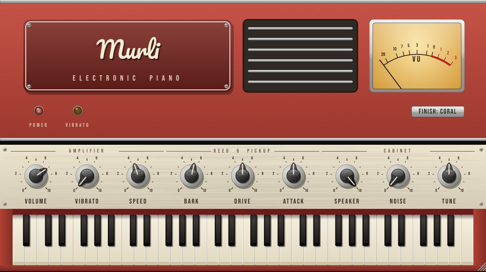

# Murli

A modelled electrostatic reed piano after the 1970s **200 / 200A** electric piano. It
runs as a **VST3**, an **Audio Unit**, and a **standalone macOS app**. It isn't affiliated
with or endorsed by the maker of the original instrument.



- **No samples.** Murli models the reeds, hammers, pickup, preamp, tremolo, power amp and lid speakers.
- **Zero latency.** The plug-in reports 0 samples of latency: there's no oversampling and
  no lookahead. Notes start on their exact sample inside the audio block. The standalone
  app asks for a 64-sample buffer at 48 kHz (≈1.3 ms) and opens every MIDI input it finds.
- **Light on CPU.** With all 64 reeds ringing, the engine uses about 4–5 % of one core
  (measured by `tests/engine_test.cpp`).
- **Retro panel.** It has chicken-head knobs, a VU meter, a vibrato lamp, a felt strip and a
  64-key keybed from A1 to C7. You can pick three cabinet finishes (Coral, Ebony, Beige),
  and the window resizes freely.

## Controls

| Knob | What it does |
|------|--------------|
| **Volume** | The volume pot between the preamp and the power amp. Turned up with hard chords, the amp starts to break up. |
| **Vibrato** | Tremolo depth. As on the original, the "vibrato" is an LDR inside the preamp's feedback loop, so it changes the timbre as well as the level. |
| **Speed** | Tremolo rate. The original runs at a fixed ≈5.6 Hz, which is the default here. |
| **Bark** | How far the reeds swing into the pickup. Turn it up for more growl and down for a rounder, cleaner tone. |
| **Drive** | Preamp input trim (±12 dB). This drive comes from the asymmetric, even-harmonic preamp. |
| **Attack** | The level of the hammer thump and of the reeds' inharmonic upper modes (the "clank"). |
| **Speaker** | Blends the direct output with the two 4"×8" lid speakers. |
| **Noise** | Preamp hiss and mains hum, for authenticity. |
| **Tune** | Reference pitch from A = 430 to 450 Hz. |

Double-click a knob to reset it. Hover over a knob to read its exact value. In the
standalone app the computer keyboard plays notes (A W S E D F T G … from middle C), and
the sustain pedal (CC64) works.

## How the model works

All of the DSP is in `Source/dsp`. It is plain C++ with no JUCE dependency, and it doesn't
allocate memory on the audio thread.

1. **Reeds (`Reed.h`).** There is one voice per key, as in the real action, so a repeated
   note strikes a reed that is still moving. Each reed is a clamped cantilever with a solder
   tip mass. Its four inharmonic bending modes come from the Euler–Bernoulli tip-mass
   eigen-equation. Each mode is a decaying phasor, and higher modes die faster (∝ ω²).
2. **Hammer.** The felt contact is a Gaussian force pulse lasting ¾ to 1 period. Harder
   blows mean shorter contact and brighter tone. A short band-passed thump is added on top.
   Felt dampers stop the notes, except on the top keys, which ring free like the original.
3. **Pickup (`PickupLaw.h`).** The reed swings into the polarised comb on one side only.
   That one-sided capacitance law is the source of the even-harmonic bark. Murli evaluates
   the law as a Chebyshev series truncated per note just below Nyquist. Because
   Tₖ(cos θ) = cos kθ, this waveshaper is band-limited by construction, with no oversampling
   (aliasing stays more than 100 dB down on the top note at 44.1 kHz). The shared pickup
   network then high-passes the summed signal near 880 Hz.
4. **Preamp and tremolo (`AmpChain.h`).** A gain stage with asymmetric headroom, using
   anti-derivative anti-aliasing. Its closed-loop gain comes from the R-10 / VIBRATO-pot /
   CdS-cell network, which is driven by a twin-T-style LFO through an LED with fast-attack,
   slow-release photocell behaviour.
5. **Power amp and speakers.** Audio-taper volume, soft rail clipping, and an open-baffle
   oval-speaker voicing with roughly 95 Hz – 7 kHz bandwidth.

The physical figures (mode amplitudes, decay laws, swing per register, the pickup corner,
the LDR network and the tremolo rate) come from the 200A service manual and schematics,
and from the research notes published by the
[OpenWurli](https://github.com/hal0zer0/openwurli) project. The Murli code is an independent
implementation; it doesn't contain any OpenWurli code.

## Building

You need CMake 3.22 or later and a C++17 compiler. The first configure downloads JUCE 8.0.4
automatically. You can point the build at a local checkout instead with
`-DMURLI_JUCE_DIR=/path/to/JUCE`.

### macOS

```bash
cmake -B build -G Xcode -DCMAKE_OSX_ARCHITECTURES="arm64;x86_64"
cmake --build build --config Release
```

The build writes these files:

- `build/Murli_artefacts/Release/VST3/Murli.vst3` → copy to `~/Library/Audio/Plug-Ins/VST3/`
- `build/Murli_artefacts/Release/AU/Murli.component` → copy to `~/Library/Audio/Plug-Ins/Components/`
- `build/Murli_artefacts/Release/Standalone/Murli.app` → copy to `/Applications`

Add `-DMURLI_COPY_AFTER_BUILD=ON` to have the plug-ins installed for you.

### Prebuilt binaries from CI

Every push runs `.github/workflows/build.yml`. That workflow builds universal (Apple
Silicon + Intel) binaries, validates them with pluginval and `auval`, and attaches them to
the run as the **Murli-macOS** artifact. These binaries are only ad-hoc signed, so macOS
quarantines them after download. Clear the quarantine flag once:

```bash
xattr -dr com.apple.quarantine ~/Library/Audio/Plug-Ins/VST3/Murli.vst3 \
  ~/Library/Audio/Plug-Ins/Components/Murli.component /Applications/Murli.app
```

### Engine tests

```bash
cmake -B build-tests -S tests && cmake --build build-tests
./build-tests/murli_engine_test [dir-for-demo-wavs]
```

The tests check the reed physics, how bark grows with velocity, aliasing, the gain staging,
the dampers, numerical safety, and CPU use. Pass a directory as an argument to also render
demo WAV files.

## Licences

- The fonts are [Pacifico](https://fonts.google.com/specimen/Pacifico) and
  [Bebas Neue](https://fonts.google.com/specimen/Bebas+Neue), both under the SIL Open Font
  License (see `Resources/fonts`).
- JUCE 8 is dual-licensed under AGPLv3 and a commercial licence. To distribute Murli as
  closed source, you need a JUCE licence; the free "Starter" tier covers small revenue.
